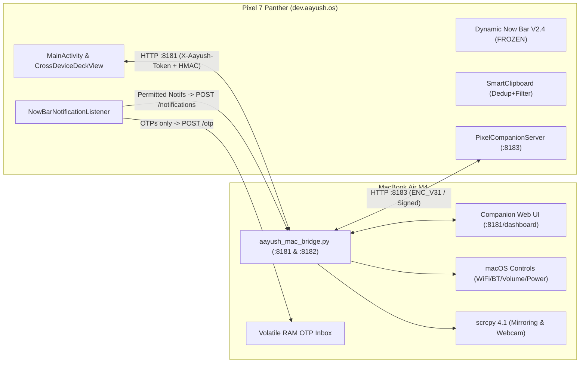

# Aayush OS V3.1 (`dev.aayush.os`) — Complete Project State & Context Handoff

> **Optimized Context Profile:** High-density system specification and handoff for LLM sessions.  
> **Last Updated:** 2026-11-02 • V3.1 Cross-Device Intelligence & Network Independence  
> **Canonical Root:** `/Users/aayushmali/Developer/Projects/AayushOS` (Symlinked from `Android TV Cleaner`)  
> **Theme / Brand:** AMOLED Obsidian (`#0A0A0A`), Carbon (`#141414`), Graphite (`#282828`), McLaren `#81` Papaya (`#FF8000`), Telemetry Green (`#00E676`).

---

## 1. Hardware & Runtime Topology

| Host / Node | Role & Hardware Specs | Network & Endpoints | Core Services / Toolchain |
| :--- | :--- | :--- | :--- |
| **Pixel 7 Panther** | Android 17 (`panther`, Serial `2A311FDH200A4A`), `1080×2400` @ `420dpi` (`2.625x`). | LAN/Hotspot/Tailscale Dynamic IP Receiver Port: `http://<pixel-ip>:8183` mDNS: `_aayush-pixel._tcp.` | Zero-Gradle build (`./build.sh` via SDK `/Users/aayushmali/.android-sdk`, `build-tools;34.0.0`, `platforms;android-34`). Outputs signed `out/aayush-os.apk` (~150 KB in 2s). Auto-provision: `./install.sh`. |
| **MacBook Air M4** | Companion Host (macOS 15+ Apple Silicon M4). | LAN/Hotspot/Tailscale Dynamic IP Daemon Port: `http://127.0.0.1:8181` UDP Beacon: `:8182` Web UI: `http://127.0.0.1:8181/dashboard` mDNS: `_aayush-os._tcp` / `Aayushs-MacBook-Air.local` | `mac-companion/aayush_mac_bridge.py` (`ThreadingHTTPServer` + UDP receiver/announcer + `scrcpy 4.1`). Swift menu bar: `mac-companion/AayushOSMenuBar.swift`. |

---

## 2. Inviolable Architectural Invariants

> [!IMPORTANT]
> 1. **Dynamic Now Bar V2.4 FROZEN & PROTECTED:** [`NowBarOverlayService.java`](file:///Users/aayushmali/Developer/Projects/AayushOS/src/dev/aayush/os/NowBarOverlayService.java), [`NowBarConfig.java`](file:///Users/aayushmali/Developer/Projects/AayushOS/src/dev/aayush/os/NowBarConfig.java), and [`NowBarCalibrationCard.java`](file:///Users/aayushmali/Developer/Projects/AayushOS/src/dev/aayush/os/NowBarCalibrationCard.java) are 100% frozen. Hardware cutout center locked at `(540px, 68px)` with `34dp` clearance. Rollback snapshot: [`backups/v2.4_stable_rollback/`](file:///Users/aayushmali/Developer/Projects/AayushOS/backups/v2.4_stable_rollback/).
> 2. **Strict OTP Isolation:** OTPs never appear in the Dynamic Now Bar (`NowBarState.getActiveOtp() == null`). Delivered exclusively to Mac RAM inbox (`POST /otp`, volatile RAM only, 1s sweeper, 30s/60s/120s TTL, never written to disk/logs).
> 3. **Strict Disconnect Policy:** User toggling Mac Wi-Fi/BT OFF triggers immediate cutoff (HTTP 200 flush, 80ms power down) and sets `manuallyDisconnected` / `wifi_off_by_user`. Never automatically reconnect or override user intent.
> 4. **HTTP vs ADB Separation:** All day-to-day companion features (telemetry, clipboard, file drop, notifications, system toggles) run wirelessly over HTTP (`:8181` ↔ `:8183`) with ADB disabled (`adb_enabled 0`). ADB is strictly activated on-demand only for `scrcpy` mirroring and camera feeds.

---

## 3. Implementation Matrix & Current Phase Status

| Phase | Capability | Status | Verified Implementation Details |
| :--- | :--- | :--- | :--- |
| **Phase 0** | Stability & V2.4 Baseline | **[TESTED]** | Zero crash verified in `logcat -b crash`. Rollback safely archived at `backups/v2.4_stable_rollback/`. |
| **Phase 1** | Mac System Remote Control | **[TESTED]** | 13 Mac controls: Wi-Fi ON/OFF (`networksetup`), Bluetooth ON/OFF (`IOBluetooth`), Battery/Charging (`pmset`), CPU/Load (`top`/`sysctl`), Uptime, Connected BT devices, Screen Lock, Caffeinate toggle, Volume/Mute, Dark Mode, Ping profiler, Sound chime (`afplay`). |
| **Phase 2** | Wireless Independence | **[TESTED]** | [`PixelCompanionServer.java`](file:///Users/aayushmali/Developer/Projects/AayushOS/src/dev/aayush/os/PixelCompanionServer.java) on `:8183`. Status, clipboard push, and file receive work with ADB OFF. Granted permissions persist. |
| **Phase 3** | `scrcpy 4.1` Mirroring | **[TESTED]** | Integrated in [`aayush_mac_bridge.py`](file:///Users/aayushmali/Developer/Projects/AayushOS/mac-companion/aayush_mac_bridge.py) and [`CrossDeviceDeckView.java`](file:///Users/aayushmali/Developer/Projects/AayushOS/src/dev/aayush/os/CrossDeviceDeckView.java). Mirroring, resolutions (720p–2400p), bitrates (4M–16M), orientation, nav keys. Requires wireless (`adb tcpip 5555`) or USB ADB. |
| **Phase 4** | Pixel as Mac Webcam | **[TESTED]** | Scrcpy camera feed (`--video-source=camera`, rear `4080×3072` / front `3440×2448` up to 60fps) + Android 17 `DeviceAsWebcam` USB UVC helper for native FaceTime/Zoom. |
| **Phase 5** | Mac OTP Inbox | **[TESTED]** | Volatile RAM store, 1s auto-purge sweeper, app allowlist, privacy redaction respect, 1-click Copy on Mac. Zero Now Bar leakage. |
| **Phase 6** | Bidirectional Clipboard | **[TESTED]** | SHA-256 deduplication, regex exclusion (`SECRET_PATTERN`, `OTP_PATTERN`), focus sync, configurable history (15m/30m/60m) in [`SmartClipboard.java`](file:///Users/aayushmali/Developer/Projects/AayushOS/src/dev/aayush/os/SmartClipboard.java). |
| **Phase 7** | Wireless File Transfer | **[TESTED]** | Streaming 16KB chunked upload (`POST /file/upload`) & download (`GET /file/download`), speed calculation (`KB/s`), progress indicator, folder picker (`PixelDrop`/Desktop/Docs), cancel support. |
| **Phase 8** | Mac Notification Centre | **[TESTED]** | Non-OTP notification forwarding to macOS banners, app category filters, link opener, remote dismiss on Pixel via `:8183/dismiss-notif`. |
| **Phase 9–10**| Cross-Device Command Centre | **[TESTED]** | Dual telemetry panels (Pixel 7 × Mac M4) + 10 live quick pills in [`CrossDeviceDeckView.java`](file:///Users/aayushmali/Developer/Projects/AayushOS/src/dev/aayush/os/CrossDeviceDeckView.java). Refined header spacing and McLaren papaya accents. |
| **Phase 11** | Security Hardening | **[TESTED]** | RFC1918 LAN enforcement, `X-Aayush-Token` auth (`HTTP 401`), `shell=False` subprocess execution, strict command allowlists. |
| **Phase 12** | Multi-Network & Tailscale | **[TESTED]* | Signed UDP `:8182` beacon, mDNS (`_aayush-os._tcp` / `_aayush-pixel._tcp.`), ARP resolution, Tailscale fallback (`100.64.0.0/10`), client isolation audit (`/network/audit`), `ENC_V31` stream cipher (`SHA256-CTR` + `HMAC-SHA256`). *Note: Verified on Home Wi-Fi + Pixel Hotspot. Office Wi-Fi live test pending.* |

---

## 4. Source Directory Map (`/Users/aayushmali/Developer/Projects/AayushOS/`)

- **Root Build Scripts & Configs:**
  - [`build.sh`](file:///Users/aayushmali/Developer/Projects/AayushOS/build.sh) — 2-second fast SDK build (`aapt2` + `javac` + `d8` + `zipalign` + `apksigner`).
  - [`install.sh`](file:///Users/aayushmali/Developer/Projects/AayushOS/install.sh) — Build, install APK, and grant ADB privileged permissions.
  - [`AndroidManifest.xml`](file:///Users/aayushmali/Developer/Projects/AayushOS/AndroidManifest.xml) — Package permissions, overlay service, notification listener, receivers.
  - [`AAYUSH_OS_STATE.md`](file:///Users/aayushmali/Developer/Projects/AayushOS/AAYUSH_OS_STATE.md) — Master state & handoff document (this file).

- **Android Java Sources (`src/dev/aayush/os/`):**
  - **Dynamic Now Bar (Frozen V2.4):** [`NowBarOverlayService.java`](file:///Users/aayushmali/Developer/Projects/AayushOS/src/dev/aayush/os/NowBarOverlayService.java) • [`NowBarConfig.java`](file:///Users/aayushmali/Developer/Projects/AayushOS/src/dev/aayush/os/NowBarConfig.java) • [`NowBarCalibrationCard.java`](file:///Users/aayushmali/Developer/Projects/AayushOS/src/dev/aayush/os/NowBarCalibrationCard.java) • [`NowBarNotificationListener.java`](file:///Users/aayushmali/Developer/Projects/AayushOS/src/dev/aayush/os/NowBarNotificationListener.java) • [`NowBarState.java`](file:///Users/aayushmali/Developer/Projects/AayushOS/src/dev/aayush/os/NowBarState.java) • [`NowBarTileService.java`](file:///Users/aayushmali/Developer/Projects/AayushOS/src/dev/aayush/os/NowBarTileService.java)
  - **Cross-Device & Wireless:** [`MacCompanion.java`](file:///Users/aayushmali/Developer/Projects/AayushOS/src/dev/aayush/os/MacCompanion.java) • [`CrossDeviceDeckView.java`](file:///Users/aayushmali/Developer/Projects/AayushOS/src/dev/aayush/os/CrossDeviceDeckView.java) • [`PixelCompanionServer.java`](file:///Users/aayushmali/Developer/Projects/AayushOS/src/dev/aayush/os/PixelCompanionServer.java)
  - **Core Modules:** [`MainActivity.java`](file:///Users/aayushmali/Developer/Projects/AayushOS/src/dev/aayush/os/MainActivity.java) • [`Theme.java`](file:///Users/aayushmali/Developer/Projects/AayushOS/src/dev/aayush/os/Theme.java) • [`HardwareMonitor.java`](file:///Users/aayushmali/Developer/Projects/AayushOS/src/dev/aayush/os/HardwareMonitor.java) • [`SmartClipboard.java`](file:///Users/aayushmali/Developer/Projects/AayushOS/src/dev/aayush/os/SmartClipboard.java) • [`DeveloperToolbox.java`](file:///Users/aayushmali/Developer/Projects/AayushOS/src/dev/aayush/os/DeveloperToolbox.java) • [`PersonalAiAssistant.java`](file:///Users/aayushmali/Developer/Projects/AayushOS/src/dev/aayush/os/PersonalAiAssistant.java) • [`AiProcessTextActivity.java`](file:///Users/aayushmali/Developer/Projects/AayushOS/src/dev/aayush/os/AiProcessTextActivity.java) • [`SmartAutomation.java`](file:///Users/aayushmali/Developer/Projects/AayushOS/src/dev/aayush/os/SmartAutomation.java) • [`F1CommandCenter.java`](file:///Users/aayushmali/Developer/Projects/AayushOS/src/dev/aayush/os/F1CommandCenter.java) • [`GamingHub.java`](file:///Users/aayushmali/Developer/Projects/AayushOS/src/dev/aayush/os/GamingHub.java) • [`AayushDeckWidget.java`](file:///Users/aayushmali/Developer/Projects/AayushOS/src/dev/aayush/os/AayushDeckWidget.java) • [`VaultDialog.java`](file:///Users/aayushmali/Developer/Projects/AayushOS/src/dev/aayush/os/VaultDialog.java)

- **macOS Companion Services (`mac-companion/`):**
  - [`aayush_mac_bridge.py`](file:///Users/aayushmali/Developer/Projects/AayushOS/mac-companion/aayush_mac_bridge.py) — Python HTTP daemon (`:8181`), UDP beacon (`:8182`), Web UI dashboard (`:8181/dashboard`), OTP RAM inbox, and scrcpy manager.
  - [`AayushOSMenuBar.swift`](file:///Users/aayushmali/Developer/Projects/AayushOS/mac-companion/AayushOSMenuBar.swift) — Native macOS menu bar status indicator and controls.
