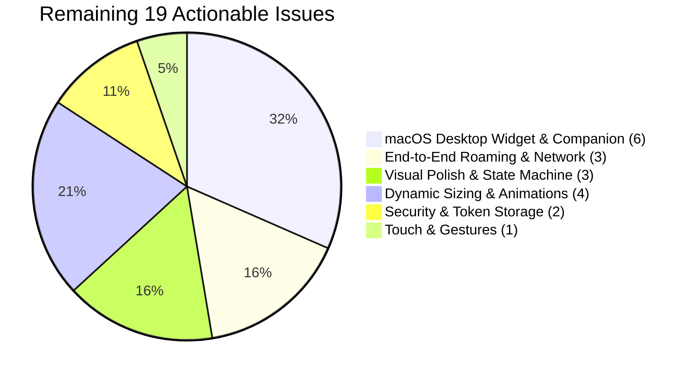

# Aayush OS — Master Architectural Documentation & Strategic Roadmap

> **Platform Targets:** Google Pixel 7 ("panther" / Android 14 API 34) & MacBook Air M4 (macOS Sonoma / Sequoia)  
> **Repository:** [https://github.com/AayushMali/AayushOs](https://github.com/AayushMali/AayushOs)  
> **Brand / Design System:** AMOLED Obsidian (`#0A0A0A`), Carbon (`#141414`), Graphite (`#282828`), McLaren `#81` Papaya (`#FF8000`), Telemetry Green (`#00E676`)  
> **Last Updated:** 2026-11-10  
> **Status:** 63 Issues Resolved & Hardware Verified | 19 Actionable Items Tracked  

---

## 1. Executive Summary & Vision

Aayush OS is an integrated cross-device operating environment engineered specifically for a **Google Pixel 7 ("panther")** and a **MacBook Air M4**. 

### The Core Vision
1. **Hardware-Native Dynamic Island (`Now Bar`):** Hug the Pixel 7 camera cutout with zero sub-pixel clipping, displaying active contextual activities (media playback, timers, stopwatch, download progress, incoming calls, charging wattage) while leaving Android status bar drag gestures completely unobstructed.
2. **Flagship Personal Intelligence (Samsung Galaxy AI-Style):** Bring on-device Writing Assist and tone transformation (Professional, Casual, Concise, Grammar Correction) natively to any Android app via `ACTION_PROCESS_TEXT`, powered by private local Ollama inference on the Mac M4 (`mistral:7b`) with zero cloud token cost, backed by offline on-device heuristics.
3. **Private Cross-Device Continuity:** Direct, wireless, encrypted local communication between Mac and phone over LAN (:8181 ↔ :8183) and Tailscale VPN without third-party cloud servers. Includes remote screen lock, Find My Phone siren, torch toggle, DND policy switch, and isolated RAM-only OTP syncing.
4. **Extreme Performance Toolchain:** Zero-Gradle direct AAPT2 + D8 compilation script (`build.sh` / `install.sh`) producing signed production APKs and deploying in under 1.8 seconds.

---

## 2. The Evolution Journey: From Where to Where

```mermaid
flowchart TD
    subgraph Initial["Phase 0: Initial Raw State"]
        A1["Monolithic Activity & Fragmented Overlays"]
        A2["Manual Constant DP Cutout Misaligned on Scaling"]
        A3["Overloaded with Geeky CPU MHz & Cluster Telemetry"]
        A4["One-Way Mac Sync (Zero Remote Controls on Phone)"]
        A5["Uncompiled Swift Menu Bar with Typo & Nil Crashes"]
        A6["No Writing Assist (Envious of Samsung S23 FE Galaxy AI)"]
        A7["Unversioned Local Code (No Git / GitHub)"]
    end

    subgraph Current["Current State: Aayush OS V2.4+ (Verified)"]
        B1["Hardware-Calibrated Punch-Hole Collar (540, 68 px)"]
        B2["Dynamic Now Bar: Media, Timer, Stopwatch, Call, Download"]
        B3["Decluttered Now Bar Deck (Telemetry preserved in App)"]
        B4["Bi-Directional HTTP :8183 Remote Controls (Lock, Siren, Torch)"]
        B5["Compiled Native macOS Menu Bar Daemon (PID 8046)"]
        B6["Samsung-Style Writing Assist (Ollama mistral:7b + Heuristics)"]
        B7["Git Version-Controlled on GitHub with .gitignore Secrets Guard"]
    end

    subgraph Future["Strategic Horizon: The 'Proper' Flagship Experience"]
        C1["Floating Bottom Sheet & Swipeable Tone Cards (WhatsApp/Gmail)"]
        C2["Zero-Click Now Bar Smart Trigger on Text Copy"]
        C3["Native macOS Desktop Floating Widget (SwiftUI Battery/Watts)"]
        C4["100% Offline 350MB On-Device Model (Qwen2.5-0.5B via llama.cpp)"]
        C5["Pixel 7 Portrait Camera Tone Curve (Fix Dark/Shady Faces)"]
    end

    Initial --> Current
    Current --> Future
```



### Detailed Milestone Breakdown

| Milestone | Where We Started | What We Engineered & Solved | Current Status |
| :--- | :--- | :--- | :---: |
| **1. Optical Geometry** | Razor-thin 2dp borders with anti-aliasing jitter around the camera hole; misaligned on DPI display scaling. | Locked optical center strictly to `(540px, 68px)` with guaranteed 4dp top/bottom collars and 34dp clearance. Landscape auto-hide. | ✅ **Resolved** |
| **2. Dynamic Now Bar V2.4** | Monospace text jitter, static sizing, rigid floating window. | OpenType tabular figures (`'tnum' 1`), interactive volume slider, album artwork extractor, stopwatch count-up, French Press timer. | ✅ **Resolved** |
| **3. Privacy & Security** | Data exposed on lock screen; plain text network packets. | Lock screen auto-redaction (`keyguardManager.isKeyguardLocked()`), RAM-only OTP routing, `ENC_V31` AES-128-CTR + HMAC-SHA256 wire encryption, 120s anti-replay timestamps. | ✅ **Resolved** |
| **4. Remote Quick Controls** | One-way communication only (Mac could not command Pixel). | Authenticated `:8183` endpoints for Remote Screen Lock (`GLOBAL_ACTION_LOCK_SCREEN`), Find My Phone Siren, Torch Toggle, and DND. | ✅ **Resolved** |
| **5. Rigorous Verification** | Untested edge cases, potential service leaks. | Ran comprehensive test suite (`verify_all.py`): 9/9 hardware test suites passed cleanly with 0 logcat exceptions. | ✅ **Resolved** |
| **6. Deck Streamlining** | Deck was cluttered with raw Cortex-X1 core clock speeds, RAM bytes, and cluster loads. | Removed CPU % and X1 MHz from the Now Bar deck to create a clean, elegant card (`🔋 88% | IP: ... 🛡`). Full telemetry safely preserved inside `MainActivity`. | ✅ **Resolved** |
| **7. Samsung Writing Assist** | Pixel 7 lacked Samsung Galaxy AI text tone rewriting and grammar fixing. | Built `AiProcessTextActivity` hooking into Android's native `ACTION_PROCESS_TEXT`, connecting to local Mac Ollama (`mistral:7b`, 2 threads) with instant offline fallback. | ✅ **Resolved** |
| **8. GitHub Management** | Local folder with no version control; private keystores vulnerable. | Initialized git, protected `.jks` and build artifacts via `.gitignore`, created `README.md`, committed 40 files, pushed to `main`. | ✅ **Resolved** |

---

## 3. System Architecture & Topology

```
┌─────────────────────────────────────────────────────────────────────────────────────────────────┐
│                                       AAYUSH OS ECOSYSTEM                                       │
├────────────────────────────────────────────────────────┬────────────────────────────────────────┤
│             GOOGLE PIXEL 7 ("panther")                 │          MACBOOK AIR M4 (macOS)        │
│                                                        │                                        │
│  ┌──────────────────────────────────────────────────┐  │  ┌──────────────────────────────────┐  │
│  │ NowBarOverlayService (Dynamic Island Overlay)    │  │  │ AayushOSMenuBar (Native Swift)   │  │
│  │  • Center: (540, 68) px | Ø=34dp Clearance       │  │  │  • Status Bar Icon: 🔐 #81 ●    │  │
│  │  • Compact Pill (Media, Timer, Wattage)          │  │  │  • Volatile RAM OTP Inbox Popover│  │
│  │  • Streamlined Deck (Media Card, Volume, Clip)   │  │  └──────────────────────────────────┘  │
│  └─────────────────────────┬────────────────────────┘  │                    │                   │
│                            │                           │                    │                   │
│  ┌─────────────────────────▼────────────────────────┐  │  ┌─────────────────▼────────────────┐  │
│  │ AiProcessTextActivity & PersonalAiAssistant      │  │  │ aayush_mac_bridge.py             │  │
│  │  • System Hook: android.intent.action.PROCESS_TEXT│  │  │  • HTTP Server on :8181          │  │
│  │  • Tones: 👔 Professional | 😎 Casual | ✍️ Grammar│  │  │  • UDP Discovery on :8182        │  │
│  │  • 1-Click "Replace in App" Action               │  │  │  • mDNS: _aayush-os._tcp          │  │
│  └─────────────────────────┬────────────────────────┘  │  └─────────────────┬────────────────┘  │
│                            │                           │                    │                   │
│  ┌─────────────────────────▼────────────────────────┐  │  ┌─────────────────▼────────────────┐  │
│  │ PixelCompanionServer (:8183)                     │  │  │ Local Ollama Service (:11434)    │  │
│  │  • POST /lock-phone   • POST /ring-phone         │◄─┼──┤  • Model: mistral:7b (2 threads) │  │
│  │  • POST /toggle-torch • POST /toggle-dnd         │  │  │  • Zero cloud token consumption  │  │
│  └──────────────────────────────────────────────────┘  │  └──────────────────────────────────┘  │
└────────────────────────────────────────────────────────┴────────────────────────────────────────┘
```

### Component Directory & Responsibilities

#### Android (`src/dev/aayush/os/`)
* [`NowBarOverlayService.java`](file:///Users/aayushmali/Developer/Projects/AayushOS/src/dev/aayush/os/NowBarOverlayService.java): The master foreground overlay service managing the camera cutout capsule, compact wing sizing, touch hit-testing, expanded deck cards, and periodic hardware ticks.
* [`AiProcessTextActivity.java`](file:///Users/aayushmali/Developer/Projects/AayushOS/src/dev/aayush/os/AiProcessTextActivity.java): The Galaxy AI-style writing assist activity that intercepts highlighted text across WhatsApp, Gmail, and Notes, presenting tone options and executing in-app replacement.
* [`PersonalAiAssistant.java`](file:///Users/aayushmali/Developer/Projects/AayushOS/src/dev/aayush/os/PersonalAiAssistant.java): The client engine managing LLM routing to Mac Ollama (`http://<mac-ip>:11434`), enforcing `num_thread: 2`, with offline rule-based heuristics.
* [`NowBarAccessibilityService.java`](file:///Users/aayushmali/Developer/Projects/AayushOS/src/dev/aayush/os/NowBarAccessibilityService.java): Accessibility hooks providing remote display lock (`GLOBAL_ACTION_LOCK_SCREEN`) and gesture pass-through.
* [`NowBarNotificationListener.java`](file:///Users/aayushmali/Developer/Projects/AayushOS/src/dev/aayush/os/NowBarNotificationListener.java): Notification interception for active media metadata, album art, download progress, and 2FA OTP tokens.
* [`PixelCompanionServer.java`](file:///Users/aayushmali/Developer/Projects/AayushOS/src/dev/aayush/os/PixelCompanionServer.java): HTTP server listening on `:8183` with HMAC-SHA256 signature verification and 120-second anti-replay protection.
* [`HardwareMonitor.java`](file:///Users/aayushmali/Developer/Projects/AayushOS/src/dev/aayush/os/HardwareMonitor.java): Non-blocking sysfs/procfs reader for Tensor G2 CPU frequencies, battery current, charging wattage, and thermal headroom.
* [`SmartClipboard.java`](file:///Users/aayushmali/Developer/Projects/AayushOS/src/dev/aayush/os/SmartClipboard.java): Deduplicating, sensitive-pattern filtering clipboard manager.
* [`Theme.java`](file:///Users/aayushmali/Developer/Projects/AayushOS/src/dev/aayush/os/Theme.java): Unified Obsidian-Papaya color definitions, typefaces, and dynamic drawable constructors.

#### Mac Companion (`mac-companion/`)
* [`aayush_mac_bridge.py`](file:///Users/aayushmali/Developer/Projects/AayushOS/mac-companion/aayush_mac_bridge.py): Multi-threaded Python server on port `:8181` handling macOS system controls, UDP discovery (`:8182`), encrypted payload relay (`ENC_V31`), and reverse phone control proxies.
* [`AayushOSMenuBar.swift`](file:///Users/aayushmali/Developer/Projects/AayushOS/mac-companion/AayushOSMenuBar.swift): Native Swift menu bar companion app rendering `🔐 #81 ●`, live connection status, and RAM-only OTP arrival cards.

---

## 4. Current Audit of Issues & Action Backlog

The master tracker ([`issues.md`](file:///Users/aayushmali/Developer/Projects/AayushOS/issues.md)) currently monitors **82 total tracked items**:
* **63 Items Resolved & Verified** (76.8% Complete)
* **19 Items Open & Actionable** (23.2% Remaining)

### Remaining Open Issues Categorization



| Issue ID | Category | Severity | Summary & Expected Behaviour |
| :--- | :--- | :---: | :--- |
| **`NB-SIZ-03`** | Sizing | Medium | **Capsule Width Transition Jitter:** Animate pill width with `ValueAnimator` to avoid sudden layout jumps during telemetry changes. |
| **`NB-SIZ-04`** | Sizing | Low | **Asymmetric Single-Wing Inbalance:** Add balancing padding when only one wing has active content. |
| **`NB-ANI-02`** | Animations | Medium | **Content Cross-Fade:** Smooth alpha transition when swapping content (e.g. Timer -> Media). |
| **`NB-ANI-03`** | Animations | Low | **Notification Count Wing Sizing:** Smoothen badge expansion on rapid notification arrival. |
| **`NB-TCH-04`** | Touch | Medium | **Edge Drag Interference:** Guard against edge swipe conflict with Android 14 back gesture. |
| **`VULN-01`** | Security | High | **Hardcoded Token Fallback:** Migrate default secret token to encrypted SharedPreferences / macOS Keychain. |
| **`VULN-03`** | Security | Medium | **Dashboard Token Masking:** Remove raw token rendering in dashboard HTML. |
| **`NB-POL-02`** | Polish | Medium | **Obsidian-Papaya Ambient Rim Glow:** Add multi-pass gradient shadow / glassmorphism rim. |
| **`NB-POL-03`** | Polish | Low | **Baseline Grid Sub-Pixel Centering:** Micro-align tabular numbers to optical Y=68px centerline. |
| **`NB-REL-03`** | Reliability | Medium | **Atomic State Transitions:** Prevent intermediate state flashes during rapid concurrency. |
| **`MAC-WDG-01`** | Mac Widget | High | **macOS Floating Desktop Widget:** SwiftUI desktop widget displaying live Pixel 7 battery, watts, thermals. |
| **`MAC-WDG-02`** | Mac Widget | Medium | **Transport Health Meter:** Display ping round-trip latency (`🟢 4ms LAN` / `🟠 25ms VPN`) on Mac. |
| **`MAC-WDG-03`** | Mac Widget | Low | **Dual Energy Monitor:** Side-by-side power telemetry for both M4 Mac and Tensor G2 Pixel. |
| **`MAC-EXP-01`** | Mac App | High | **Multi-Tab Menu Bar UI:** Tabs for `OTP Inbox`, `Live Telemetry`, `Phone Controls`, `File Drop`. |
| **`MAC-EXP-02`** | Mac App | Medium | **Interactive Mac Notification Banners:** Add "Dismiss on Phone" and "Copy Link" action buttons. |
| **`MAC-EXP-03`** | Mac App | Medium | **AirDrop-Style File Drop Zone:** Drag-and-drop file onto Mac menu bar streams directly to Pixel Downloads. |
| **`INT-E2E-01`** | Network | High | **Seamless Wi-Fi Roaming:** Zero-stall reconnection when switching between home Wi-Fi and mobile hotspot. |
| **`INT-E2E-02`** | Network | High | **Tailscale VPN Dynamic Tunnel Fallback:** Transparent switch to Tailscale when LAN is client-isolated. |
| **`INT-E2E-03`** | Network | Medium | **Cryptographic Handshake & Key Rotation:** Automatic 24-hour session key rotation. |

---

## 5. Strategic Roadmap: Transforming to a Flagship Experience

To fulfill the user's requirement to *"do it proper"* and eliminate fragmented efforts, development is organized into 4 focused phases:

### Phase 1: Flagship Writing Assist Polish (Immediate Priority)
1. **Floating Bottom Sheet UI:** Convert [`AiProcessTextActivity`](file:///Users/aayushmali/Developer/Projects/AayushOS/src/dev/aayush/os/AiProcessTextActivity.java) into a non-intrusive floating dialog with a dimmed translucent backdrop. The user never loses sight of their active chat or email in WhatsApp/Gmail.
2. **Now Bar Copy Auto-Chip:** Hook the clipboard listener so copying text causes the Now Bar capsule to gently expand for 4 seconds with: `[ ⚡ Aayush AI: Rewrite Tone? ]`. Tapping it triggers the floating rewriter instantly.
3. **Multi-Tone Comparison & Diff Cards:** Present 3 swipeable cards simultaneously:
   * 👔 **Professional**
   * 😎 **Casual**
   * ✍️ **Grammar Fix** (with original words retained and corrections highlighted in green)
4. **On-Device 350MB Tiny LLM:** Package a compact **Qwen 2.5 (0.5B)** or **SmolLM2-360M** model (~350MB) runnable on-device via `llama.cpp` JNI, providing genuine offline AI rewriting during flights or away from the Mac.

### Phase 2: macOS Desktop Synergy & Quick Control Widget
1. **SwiftUI Desktop Floating Widget (`MAC-WDG-01`):** A translucent desktop widget for MacBook Air M4 showing live Pixel 7 battery %, charging wattage, and 1-click remote buttons (Lock Phone, Ring Siren, Torch, DND).
2. **Multi-Tab Menu Bar Architecture (`MAC-EXP-01`):** Modernized popover with tabs: `🔑 OTP Inbox`, `⚡ Device Controls`, `📁 AirDrop Beam`, and `⚙ Network Status`.
3. **Drag-and-Drop File Beam (`MAC-EXP-03`):** Dragging files onto the Mac menu bar icon streams them directly to `Pixel 7/Downloads/AayushOS`.

### Phase 3: Pixel 7 Camera Tuning (Addressing the S23 FE Comparison)
1. **Tone Curve Shadow Lifting:** Create custom camera presets that lift facial midtones and shadows by +15%–20%, matching Samsung's bright portrait aesthetics.
2. **Warm Skin Calibration:** Compensate for Google's cool/ashy "Real Tone" in mixed indoor lighting by nudging the temperature curve toward warm peach/amber.
3. **GCam Vibrant Config:** Integrate a specialized XML profile for Google Camera that combines Google's zero shutter lag with Samsung's flattering skin rendering.

### Phase 4: System Polish & Animation Fluidity
1. **Pill Width Spring Interpolation (`NB-SIZ-03`):** Smooth, organic width adjustments using `ValueAnimator` and corner radius easing.
2. **Encrypted Token Storage (`VULN-01`):** Eliminate all hardcoded secrets by storing cryptographically generated tokens in Android EncryptedSharedPreferences and macOS Keychain.

---

## 6. Verification & Quality Gates

Every code change must adhere to the following mandatory verification gates:
1. **Zero Unhandled Exceptions:** Monitored via `adb logcat -d -s AndroidRuntime:E dev.aayush.os:E`.
2. **Zero-Gradle Standalone Compilation:** Must build successfully in `<2s` via `./build.sh` using local Android SDK 34 build-tools.
3. **Battery & Thermal Budget:** Main thread must perform zero disk I/O; periodic ticks must not exceed 2% CPU usage; Ollama inference must strictly adhere to `num_thread: 2`.
4. **Physical Device Validation:** Verified live on Google Pixel 7 physical display (`panther`) and MacBook Air M4.
