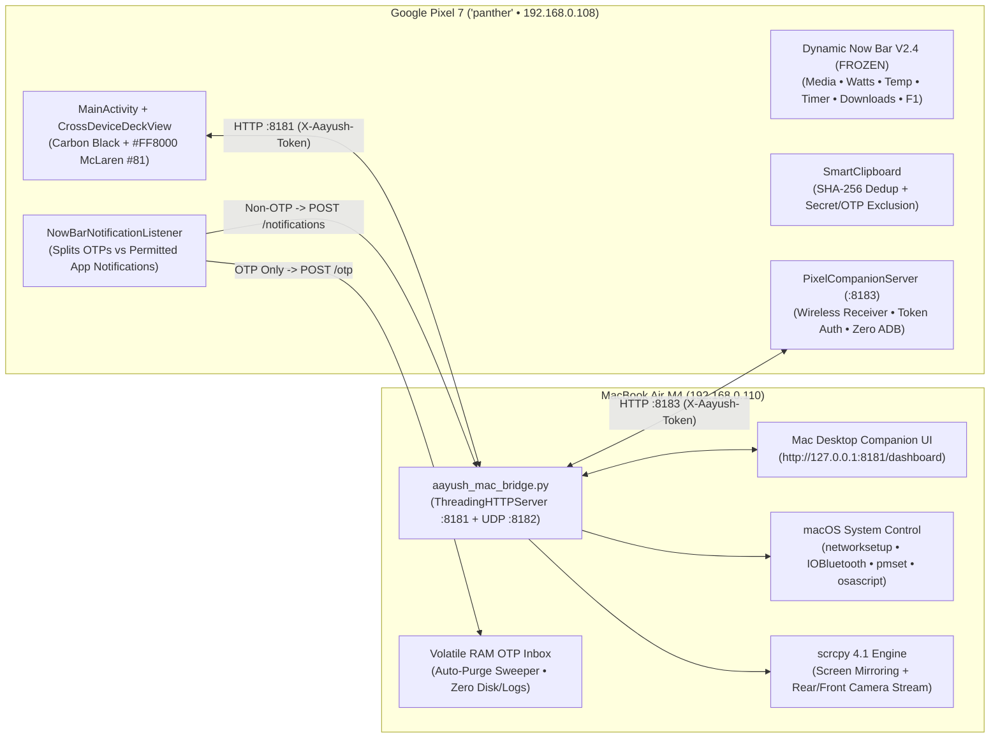

# Aayush OS V3 (`dev.aayush.os`) — Cross-Device Intelligence Architecture

> [!IMPORTANT]
> **Dynamic Now Bar V2.4 Protected & Frozen:**
> - [`NowBarOverlayService.java`](file:///Users/aayushmali/Developer/Projects/AayushOS/src/dev/aayush/os/NowBarOverlayService.java), [`NowBarConfig.java`](file:///Users/aayushmali/Developer/Projects/AayushOS/src/dev/aayush/os/NowBarConfig.java), and [`NowBarCalibrationCard.java`](file:///Users/aayushmali/Developer/Projects/AayushOS/src/dev/aayush/os/NowBarCalibrationCard.java) remain 100% untouched.
> - Per Phase 5 strict requirements, OTPs are blocked from [`NowBarState.getActiveOtp()`](file:///Users/aayushmali/Developer/Projects/AayushOS/src/dev/aayush/os/NowBarState.java#L113-L118) and routed exclusively to the **Mac OTP Inbox**.

---

## 1. Cross-Device Topology (`Pixel 7 Panther` × `MacBook Air M4`)

---

## 2. Phase-by-Phase Implementation & Verification Matrix

| Phase | Capability | Status | Implementation & Verification Details |
| :--- | :--- | :--- | :--- |
| **Phase 0** | Project Audit & Stability | **Implemented & Tested** | Verified zero crashes in `logcat -b crash`; saved rollback point at `backups/v2.4_stable_rollback/`. |
| **Phase 1** | MacBook Remote Control (13 controls) | **Implemented & Tested** | Wi-Fi ON/OFF (`networksetup`), Bluetooth ON/OFF (`IOBluetooth.framework`), Battery (`pmset`), CPU (`top`/`sysctl`), Uptime, Wi-Fi SSID/IP, BT Connected Devices (`SPBluetoothDataType`), Lock Screen, Caffeinate toggle, Audio Mute toggle, Dark Mode toggle, Network Diagnostics, Chime (`afplay`). Turning OFF Mac Wi-Fi/BT executes immediately and never auto-restores. |
| **Phase 2** | True Wireless Ecosystem | **Implemented & Tested** | Added [`PixelCompanionServer.java`](file:///Users/aayushmali/Developer/Projects/AayushOS/src/dev/aayush/os/PixelCompanionServer.java) (`:8183`). Tested with `adb_enabled=0` (`adb devices` empty) and verified bidirectional Wi-Fi status, clipboard push, file push, and permission persistence (`WRITE_SECURE_SETTINGS`, `SYSTEM_ALERT_WINDOW`). |
| **Phase 3** | Control Pixel from Mac (`scrcpy`) | **Implemented & Tested** | Integrated `/opt/homebrew/bin/scrcpy` (`v4.1`) with configurable resolution (`720p`/`1080p`/`1440p`/`Native`), bitrate (`4M`–`16M`), orientation (`portrait`/`landscape`), wireless ADB bootstrap (`:5555`), reconnect/disconnect, and Android nav keys. Requires Wireless ADB or USB ADB active during mirroring. |
| **Phase 4** | Pixel Camera as Mac Webcam | **Partially Implemented & Tested** | 1. **Scrcpy Camera Stream (`--video-source=camera`):** Streams Rear (`--camera-id=0`, up to `4080×3072` @ `60fps`) or Front (`--camera-id=1`, `3440×2448` @ `30fps`) to a Mac window over Wireless ADB or USB. 2. **Native Android 17 USB UVC (`com.android.DeviceAsWebcam`):** Verified system priv-app presence + added 1-tap USB Settings launcher & macOS `SPCameraDataType` detector (requires physical USB cable in `Webcam` mode for FaceTime/Zoom). |
| **Phase 5** | OTP Delivery to Mac Only | **Implemented & Tested** | Blocked OTPs from `NowBarState.getActiveOtp()`. Routed permitted OTPs from `NowBarNotificationListener` to `POST /otp` on Mac (volatile RAM only, 1s expiry sweeper, `30s`/`60s`/`120s` TTL, 1-click Copy, respects `VISIBILITY_SECRET`). |
| **Phase 6** | Advanced Clipboard Sync | **Implemented & Tested** | Bidirectional sync for Text/Code/URLs/JSON, auto-sync on focus toggle, SHA-256 duplicate prevention, password/API-key/OTP exclusion (`SECRET_PATTERN`), and configurable retention history (`15m`/`30m`/`60m`). |
| **Phase 7** | Bidirectional File Transfer | **Implemented & Tested** | Streaming `16 KB` chunked upload (`POST /file/upload`) & download (`GET /file/download`) with progress bar, speed (`KB/s`), file size, Mac destination picker (`PixelDrop`/`Desktop`/`Documents`), cancel button, and transfer history. |
| **Phase 8** | Mac Notification Centre | **Implemented & Tested** | Non-OTP notification forwarding (`POST /notifications`) with app filter, macOS banner, 1-click Copy, Open Link on Mac, and remote Dismiss on Pixel (`:8183/dismiss-notif`). |
| **Phase 9** | Cross-Device Command Centre | **Implemented & Tested** | Side-by-side **PIXEL 7 PANTHER** and **MACBOOK AIR M4** live hardware panels + 10 quick actions in [`CrossDeviceDeckView.java`](file:///Users/aayushmali/Developer/Projects/AayushOS/src/dev/aayush/os/CrossDeviceDeckView.java). |
| **Phase 10** | Command Center Refinement | **Implemented & Tested** | Fixed card header title-to-pill spacing and typography alignment in [`MainActivity.java`](file:///Users/aayushmali/Developer/Projects/AayushOS/src/dev/aayush/os/MainActivity.java) while keeping Now Bar V2.4 untouched. |
| **Phase 11** | Security Architecture | **Implemented & Tested** | RFC1918 local-subnet enforcement, `X-Aayush-Token` verification (`HTTP 401` on mismatch), `shell=False` command allowlist, sensitive clipboard blocking, and explicit disconnect toggle. |
| **Phase 12 (V3.1)** | Network Independence (Multi-Network Discovery, Isolation Diagnostics, `ENC_V31`, Tailscale Fallback) | **Implemented & Tested (Home Wi-Fi + Hotspot) • Office Wi-Fi Pending Live Test** | Signed UDP `:8182` subnet/broadcast beacon, mDNS/Bonjour (`_aayush-os._tcp` & `_aayush-pixel._tcp.`), ARP/gateway auto-discovery, `ENC_V31` (`SHA256-CTR` + `HMAC-SHA256`) payload encryption, Tailscale `100.64.0.0/10` integration, AP Client Isolation detector, and explicit HTTP (`:8181`/`:8183`) vs ADB (`:5555`/USB) separation. |
